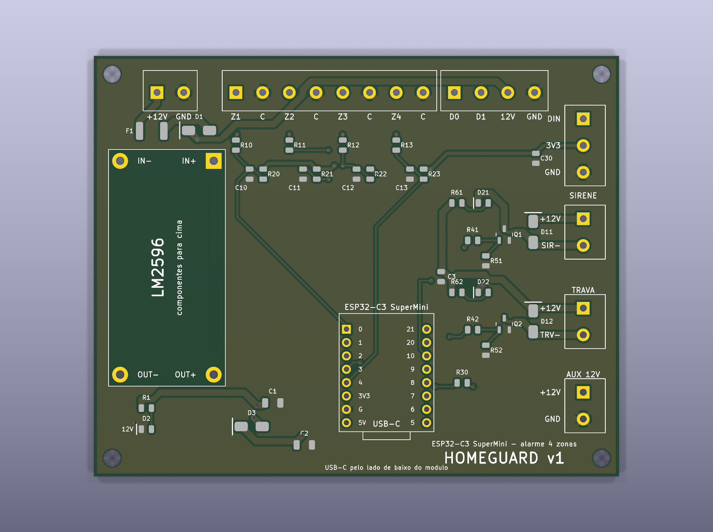
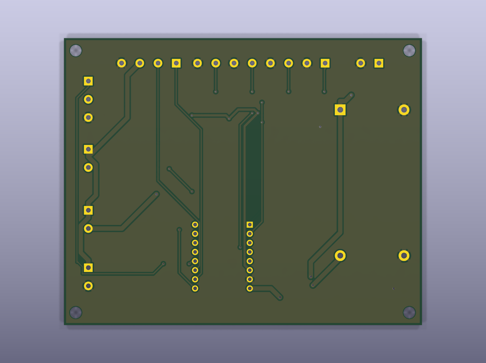

# Placa Homeguard v1





Placa de 100 × 80 mm para o alarme Homeguard: ESP32-C3 SuperMini em soquete, 4 zonas,
teclado Wiegand, saídas de sirene e trava por MOSFET, pixel RGB externo e 12 V auxiliar.

## Arquivos para a PCBWay

Tudo em [`fabricacao/`](fabricacao/):

| Arquivo | Onde vai no pedido |
|---|---|
| `homeguard_gerber.zip` | Gerber da placa (cobre, máscara, serigrafia, pasta, contorno e furação) |
| `homeguard_bom.csv` | BOM da montagem |
| `homeguard_pos.csv` | Centroid / pick-and-place |

### Opções do pedido

**Placa:** 2 camadas · 100 × 80 mm · FR-4 1,6 mm · cobre 1 oz · HASL sem chumbo ·
máscara verde, serigrafia branca · trilha/espaço mínimos 0,15/0,2 mm (6 mil, padrão) · furo mínimo 0,4 mm.

**Montagem:** só o lado de cima (*Top side*), SMD + THT, *Turnkey* (a PCBWay compra as peças).
São 34 peças SMD e 9 THT, em 21 itens de BOM.
O **U2 (módulo LM2596) não é montado**: está marcado como *DO NOT PLACE* e você solda.

Para o primeiro lote, peça poucas placas (5 fabricadas, 2 montadas). O roteamento foi
automático (FreeRouting) e passou no DRC do KiCad sem nenhuma violação, mas é a primeira
revisão e ninguém revisou à mão.

## O que você faz quando chegar

1. **Ajuste o LM2596 ANTES de ligar o ESP.** O módulo vem de fábrica com a saída em qualquer
   tensão, às vezes perto do máximo, e isso queima o SuperMini. Alimente só o módulo com 12 V,
   gire o trimpot até medir **5,3 V** entre OUT+ e OUT−, e só depois solde o módulo na placa.
   São 5,3 V e não 5,0 V porque o diodo D3 (que separa o conversor da USB) derruba ~0,35 V.
2. **Solde o módulo LM2596 por cima, com os componentes dele para cima**, IN na parte de
   cima da placa. Confira antes de soldar: o **IN+ do módulo cai no furo quadrado**, à
   direita do IN−, e o OUT+ também fica à direita do OUT−. É a mesma orientação da serigrafia
   do próprio módulo. Use barra de pinos macho com o espaçador plástico entre as duas
   placas; sob o módulo a face de cima não tem cobre, mas o vão evita esmagar as soldas dele
   contra a máscara. Os furos são largos para aceitar perna de fio, se o seu módulo não
   encaixar direto.
3. **Solde as barras macho no SuperMini** (se ainda não tiver) e encaixe no soquete com a
   **USB-C virada para a borda de baixo**, como desenhado na serigrafia.

## Bornes

| Borne | Vias | Ligação |
|---|---|---|
| J1 | +12V · GND | Fonte de 12 V |
| J2 | Z1 · C · Z2 · C · Z3 · C · Z4 · C | Um sensor por par (zona + comum) |
| J3 | D0 · D1 · 12V · GND | Teclado Wiegand |
| J4 | DIN · 3V3 · GND | Pixel RGB endereçável (SK6812) |
| J5 | +12V · SIR− | Sirene (positivo no +12V, negativo no SIR−) |
| J6 | +12V · TRV− | Trava |
| J9 | +12V · GND | 12 V sempre ligado (sensor de presença, etc.) |

As saídas J5 e J6 chaveiam o **negativo** da carga. Elas aguentam ~1 A cada pela largura
das trilhas, e o fusível F1 corta tudo acima de ~2 A no total.

## Circuito

- **Entrada:** F1 (PTC 2 A) → D1 (SS54, protege contra fonte invertida) → barramento +12 V.
- **5 V do ESP:** LM2596 → D3 (SS14) → pino 5V. O D3 deixa a USB e o conversor ficarem
  ligados ao mesmo tempo sem que um alimente o outro ao contrário.
- **Zonas (GPIO 0, 1, 3, 4):** 1 kΩ em série, pull-up de 10 kΩ para 3V3 e 100 nF para GND.
  Fechada = nível baixo, como antes.
- **Saídas (GPIO 10 sirene, GPIO 5 trava):** AO3400A, que fecha totalmente com 3,3 V,
  com 100 Ω no gate e pull-down de 100 kΩ (desligado durante o boot), diodo de flyback SS34
  e LED indicador.
- **Pixel (GPIO 8):** 330 Ω em série no dado; em paralelo com o LED RGB do próprio SuperMini.
- **Livres:** GPIO 2, 9, 20 e 21 não estão ligados.

O firmware não muda: os pinos e a lógica (`HIGH` = liga) são os mesmos de
[`homeguard.ino`](../../homeguard.ino).

## Regerar

```bash
python3 gerar_placa.py                                # disposição e redes
python3 rotear.py --freerouting /caminho/freerouting.jar   # trilhas, GND, DRC e fabricacao/
```

Precisa do KiCad 10 (com o módulo Python `pcbnew`) e do
[FreeRouting](https://github.com/freerouting/freerouting) com Java.

Medidas dos módulos, tiradas de footprints publicados:
SuperMini com fileiras a 15,24 mm
([footprint de referência](https://gitlab.warpzone.ms/infrastruktur/speaker-switcher/-/blob/a1d6ea9e9f12e4f386fc843185724b4619c5ae06/hardware/KiCad_ESP32-C3-SuperMini/ESP32-C3-SuperMini.pretty/ESP32-C3-SuperMini.kicad_mod));
LM2596 com furos a 40,64 × 17,78 mm
([KiCad-Chinese_Modules](https://github.com/yet-another-average-joe/KiCad-Chinese_Modules)).
